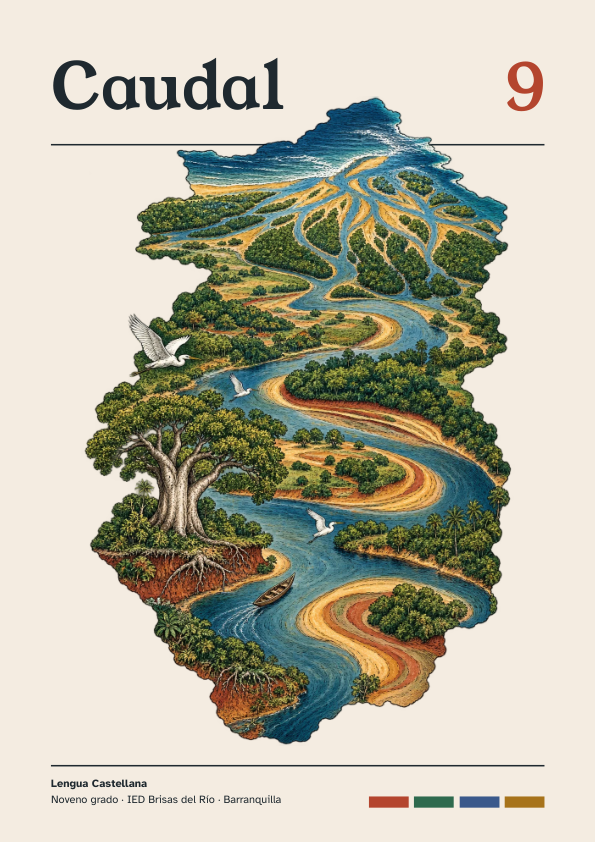
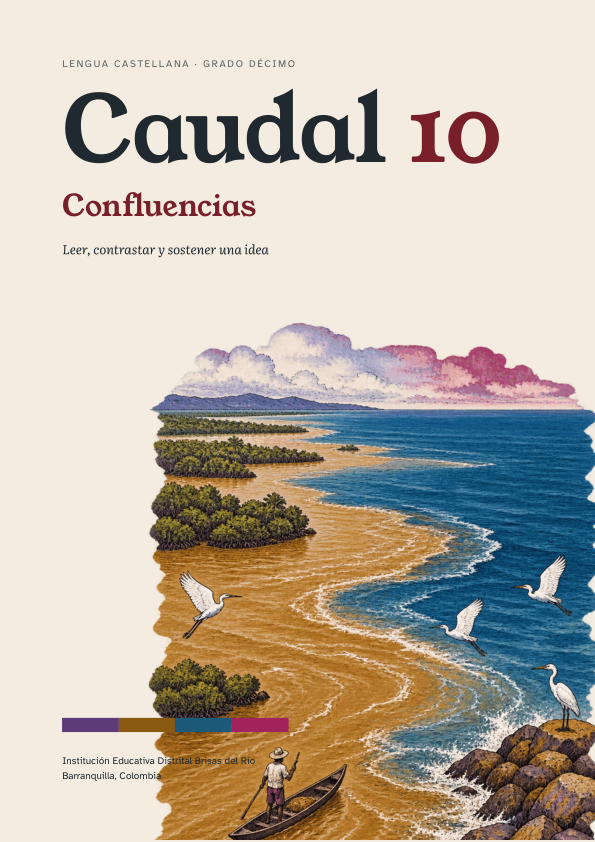
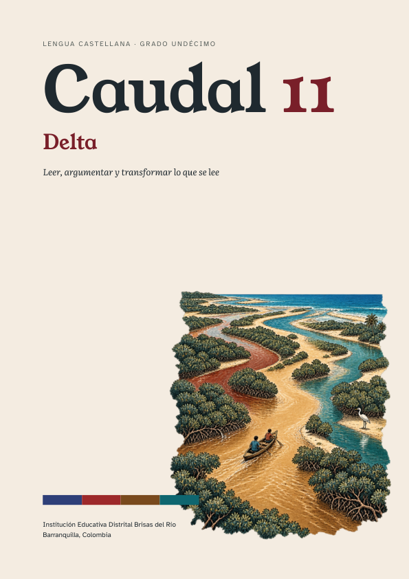
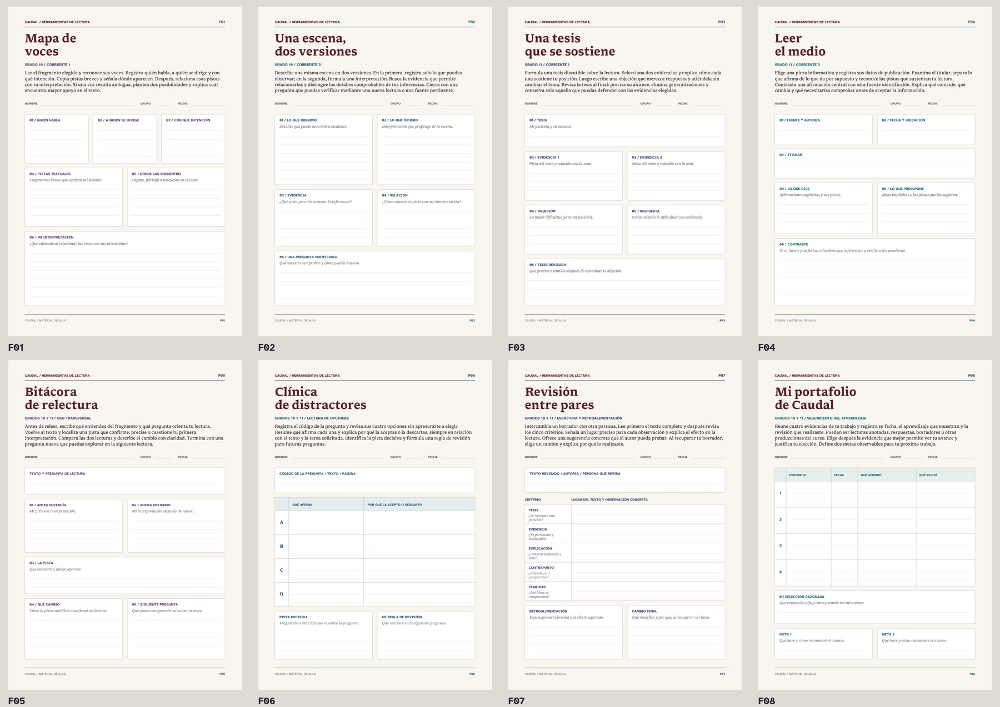

# Caudal

### Lengua Castellana · Grados 9, 10 y 11

**Leer, conversar, crear y volver a pensar.**

Proyecto en curso · v0.1.0 · Barranquilla, Colombia

[Libros y descargas](#libros-y-descargas) · [Recursos para el aula](#recursos-para-el-aula) · [Investigación](#un-proyecto-en-construccion) · [Licencia](DERECHOS.md)

---

Caudal propone un recorrido por la literatura, las voces del territorio y las preguntas que los jóvenes pueden hacerle al mundo. Cada grado reúne lecturas, imágenes, conversación, escritura y actividades de creación; la interpretación se trabaja al lado de la argumentación y de la revisión de lo que se produce.

**Autoría y dirección pedagógica: Néstor Fernando De León Llanos.** Colección desarrollada para la Institución Educativa Distrital Brisas del Río, Barranquilla.

## Libros y descargas

Los enlaces de las portadas descargan los **PDF completos y originales**. Se conservan su contenido, diseño, paginación y créditos.

<table><tr>
<td align="center" width="33%"> <strong>Caudal 9</strong> Lengua Castellana 305 páginas  <a href="https://github.com/nestorfernando3/caudal/releases/download/v0.1.0/caudal-9-libro-del-estudiante.pdf"><strong>Descargar libro completo</strong></a></td>
<td align="center" width="33%"> <strong>Caudal 10</strong> Confluencias 109 páginas  <a href="https://github.com/nestorfernando3/caudal/releases/download/v0.1.0/caudal-10-libro-del-estudiante.pdf"><strong>Descargar libro completo</strong></a></td>
<td align="center" width="33%"> <strong>Caudal 11</strong> Delta 169 páginas  <a href="https://github.com/nestorfernando3/caudal/releases/download/v0.1.0/caudal-11-libro-del-estudiante.pdf"><strong>Descargar libro completo</strong></a></td>
</tr></table>

### Caudal 9 · El corazón, las palabras y el entorno

Una entrada a la lectura literaria que conecta emociones, formas de narrar y problemas del entorno. El Romanticismo, el Realismo, el Naturalismo, el Modernismo y las rupturas de la vanguardia se encuentran con la crónica, el teatro, el debate y la escritura propia. La colección empieza por aprender a leer con atención y a sostener una interpretación con pistas del texto.

Sus cuatro unidades son *El corazón y el espejo*, *La selva que devora*, *Lo que dicen las palabras* y *Romper el molde*. El volumen incorpora diagnóstico, actividades, Banco Saber, glosario y portafolio.

### Caudal 10 · Confluencias

**Leer, contrastar y sostener una idea.** El diálogo entre épocas y voces orienta un recorrido por la literatura medieval, el Siglo de Oro, el Romanticismo y las vanguardias. Las lecturas se ponen en relación con discursos, imágenes, datos y preguntas del presente; el trabajo conduce a contrastar versiones, construir argumentos y responder objeciones.

Sus cuatro corrientes son *Quien canta, cuenta*, *Lo que se dice a media voz*, *Ver para contar* y *Romper y sostener*. También pueden descargarse como cuadernillos independientes desde la [publicación de la colección](https://github.com/nestorfernando3/caudal/releases/tag/v0.1.0).

### Caudal 11 · Delta

**Leer, argumentar y transformar lo que se lee.** La tragedia, el ensayo, la sátira, la poesía, la narrativa y los textos de circulación pública ofrecen tensiones para formular problemas y construir una posición propia. El recorrido incluye expedientes de fuentes, escritura de opinión, discusión editorial, reseña comparativa y transformación de un texto en otro formato.

Sus cuatro corrientes son *Mirar de frente*, *Voces a contracorriente*, *El peso del medio* y *Cambiar de forma*. El libro se acompaña de un simulacro de 41 preguntas de práctica, guía docente y biblioteca de lecturas.

### Bibliotecas y acompañamiento docente

| Grado | Biblioteca del río | Guía del docente |
|---|---|---|
| 9.º | [Descargar lecturas](https://github.com/nestorfernando3/caudal/releases/download/v0.1.0/caudal-9-biblioteca-del-rio.pdf) | [Descargar guía](https://github.com/nestorfernando3/caudal/releases/download/v0.1.0/caudal-9-guia-docente.pdf) |
| 10.º | [Descargar lecturas](https://github.com/nestorfernando3/caudal/releases/download/v0.1.0/caudal-10-biblioteca-del-rio.pdf) | [Descargar guía](https://github.com/nestorfernando3/caudal/releases/download/v0.1.0/Caudal_10_Guia_para_el_docente.pdf) |
| 11.º | [Descargar lecturas](https://github.com/nestorfernando3/caudal/releases/download/v0.1.0/caudal-11-biblioteca-del-rio.pdf) | [Descargar guía](https://github.com/nestorfernando3/caudal/releases/download/v0.1.0/caudal-11-guia-docente.pdf) |

También está disponible la [guía complementaria de Caudal 11](https://github.com/nestorfernando3/caudal/releases/download/v0.1.0/Caudal_11_Guia_para_el_docente.pdf). El [catálogo completo](docs/CATALOGO.md) identifica cada PDF y su extensión. Todas las descargas están reunidas en la [publicación v0.1.0](https://github.com/nestorfernando3/caudal/releases/tag/v0.1.0).

## Una ruta que recorre la colección

| Momento | Qué pone en movimiento |
|---|---|
| **Nacimiento** | Una pregunta y un punto de partida. |
| **Dialogar** | Saberes, experiencias y primeras posiciones. |
| **Leer la corriente** | Lecturas para detenerse, interpretar y volver al texto. |
| **Confluencia** | Cruces entre obras, imágenes, datos y otras voces. |
| **Construir** | Herramientas de lengua, escritura y argumentación. |
| **Transformar** | Una producción que pone en juego lo aprendido. |
| **Orilla Saber** | Preguntas de práctica y revisión de las razones de cada respuesta. |
| **Desembocadura** | Balance del recorrido y huellas para el portafolio. |

## Recursos para el aula

Ocho fichas acompañan la lectura y la producción: **Mapa de voces**, **Una escena, dos versiones**, **Una tesis que se sostiene**, **Leer el medio**, **Bitácora de relectura**, **Clínica de distractores**, **Revisión entre pares** y **Mi portafolio de Caudal**. Se ofrecen en PDF para imprimir y en SVG para editar.

[Descargar las ocho fichas juntas](recursos/fichas/Caudal_Fichas_Imprimibles.pdf) · [Explorar fichas editables](recursos/fichas/) · [Iconos y separadores](recursos/vectores/) · [Alternativas de cubierta](recursos/portadas/)

El [ZIP de recursos](https://github.com/nestorfernando3/caudal/releases/download/v0.1.0/Caudal_recursos_publicos_v0.1.0.zip) reúne los materiales independientes, sus archivos editables, imágenes y tipografías con las licencias correspondientes. Para editar las cubiertas SVG, conserva las carpetas `portadas/`, `arte-original/` y `fuentes/` con su estructura.

## Un proyecto en construcción

Caudal se vincula con el trabajo doctoral del autor sobre la cocreación de experiencias de aprendizaje, las decisiones de los jóvenes y sus relaciones con el docente, los compañeros y las actividades. La colección ofrece materiales sobre los que leer, discutir, proponer y revisar en conjunto.

Esta publicación documenta un proyecto pedagógico en curso. Los materiales disponibles permiten conocer su diseño; los resultados de investigación se comunicarán a través de sus productos académicos. El repositorio público no contiene datos personales ni respuestas individuales de estudiantes. Los decks y las presentaciones de trabajo se conservan en un archivo privado.

[Conocer el vínculo con la investigación y la trazabilidad de versiones](docs/INVESTIGACION.md).

## Cómo citar

> De León Llanos, N. F. (2026). *Caudal: Lengua Castellana, grados 9, 10 y 11* (v0.1.0) [Proyecto en curso y materiales pedagógicos]. GitHub. https://github.com/nestorfernando3/caudal

Para citar un libro o una ficha, añade su título y la página o sección utilizada. Los [metadatos de cita](CITATION.cff), el [catálogo de PDF](docs/CATALOGO.json) y los [manifiestos de archivos](MANIFEST.json) permiten identificar las versiones.

## Licencia y créditos

© 2026 Néstor Fernando De León Llanos. **CC BY-SA 4.0 para los aportes originales del autor**, con las exclusiones detalladas en [DERECHOS.md](DERECHOS.md). Las obras literarias, traducciones, documentos, fotografías y datos de terceros conservan sus créditos y su régimen de derechos. La descarga de un libro no relicencia esos contenidos. Las tipografías conservan SIL Open Font License.

Las ilustraciones interpretativas generadas con inteligencia artificial se declaran como tales; no sustituyen documentos históricos ni fotografías. Las portadas mostradas arriba son reproducciones de los PDF originales.

[Texto completo de la licencia](LICENSE) · [Resumen oficial de CC BY-SA 4.0](https://creativecommons.org/licenses/by-sa/4.0/deed.es) · [Registro de versiones](CHANGELOG.md)
